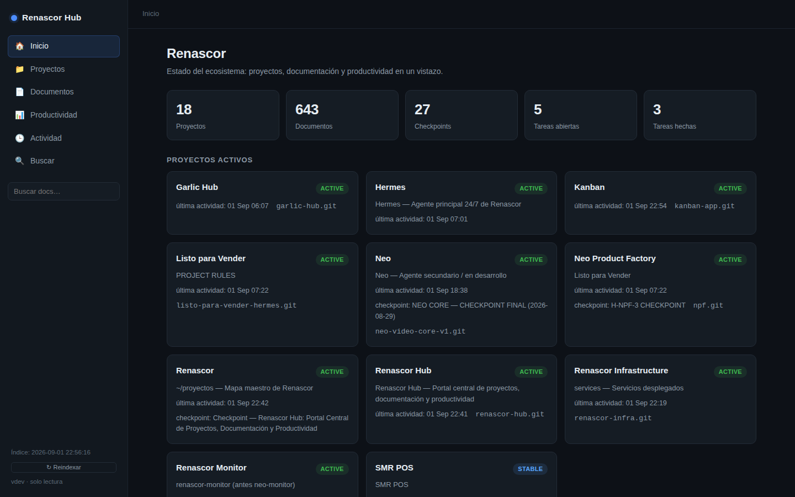
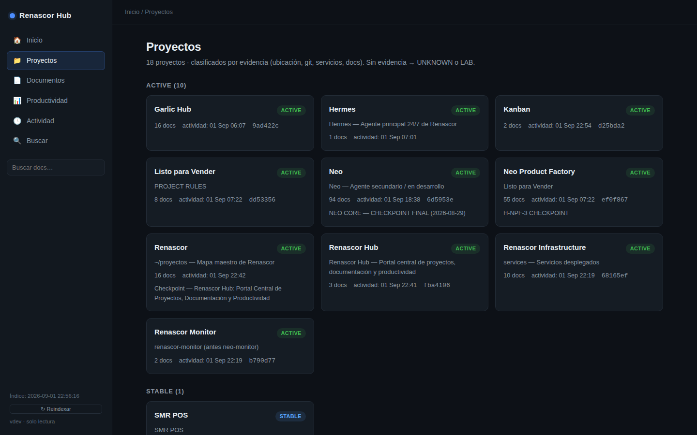
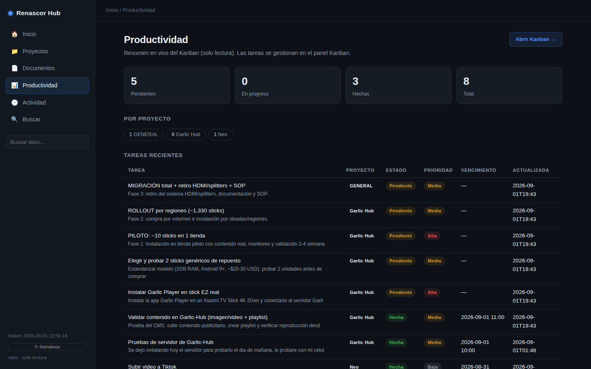

# Renascor Hub

Portal interno de proyectos y documentación. Un solo sitio donde se ve en qué estado está cada proyecto leyendo lo que ya existe en disco: repositorios, checkpoints, bitácoras y el tablero Kanban.

## El problema que resuelve

Dieciocho proyectos, 643 documentos repartidos en carpetas, y la pregunta *"¿en qué quedó esto?"* contestada a base de `grep` y memoria. GitHub no lo responde: un repo privado guarda código, no la historia de las decisiones. Y un Notion paralelo obliga a mantener todo a mano — dos fuentes de verdad que se desincronizan el primer día.

La decisión del proyecto fue la contraria: **no crear contenido, sino indexar el que ya existe.**

## Qué hace

- **Índice de búsqueda propio** sobre SQLite FTS5: 643 documentos, búsqueda por texto completo en una sola consulta, sin depender de ninguna API externa.
- **Clasificación por evidencia.** Cada proyecto se marca leyendo señales reales: ubicación en disco, repositorio `.git` con historial, servicios desplegados y documentación asociada. Si no hay evidencia, se marca `UNKNOWN` o `LAB` — nunca se inventa un estado.
- **Detección de duplicados** y lectura de front-matter para fechas, tipo y proyecto.
- **Productividad en el mismo sitio:** checkpoints por proyecto, registro de decisiones, actividad reciente y el Kanban (tareas abiertas frente a hechas).
- **API JSON** para todo lo anterior: `/api/search`, `/api/stats`, `/api/raw/<id>`, `/api/favorites`, `/health`.

## Cuatro decisiones que explican el código

1. **Solo lectura.** El Hub no edita, no crea, no mueve archivos. Es un visor con permiso de escritura únicamente sobre su propia base de datos. Menos superficie, cero riesgo de corromper la fuente de verdad.
2. **Auditoría de secretos antes de exponer.** Antes de mostrar un documento se busca dentro su contenido: llaves privadas, tokens de GitHub, JWT, credenciales de AWS o Slack. Si aparece alguno, el archivo se excluye entero y solo se registra la ruta y el motivo — nunca el valor. Un portal que indexa tu carpeta personal no puede ser la puerta por la que se filtren las llaves.
3. **FTS5 y no `grep`.** Buscar 643 documentos escaneando archivos tarda segundos; con el índice invertido es instantáneo y permite ordenar por relevancia.
4. **Un proceso, sin colas.** Servicio `systemd`, Flask con el servidor de producción, sin workers ni Redis. Para un equipo de una persona, la complejidad operativa es el enemigo.

## Stack

Python 3 · Flask · SQLite FTS5 · Jinja2 · JavaScript sin framework · CSS propio

Alrededor de 1,100 líneas de Python y 10 plantillas. Dos suites de comprobación: validación funcional E2E y QA visual con Playwright (escritorio y móvil).

## Estado

Funcional y en uso diario desde septiembre de 2026. Indexa 18 proyectos y actualiza su índice al vuelo; el endpoint `/health` y `/api/stats` dan el estado del índice, los duplicados detectados y los documentos excluidos por seguridad.

## Sobre el código

Este repositorio es **documentación de exhibición**: describe el sistema, sus decisiones y su interfaz. El código fuente no se distribuye.

© 2026 Javier Cuevas. Todos los derechos reservados. Disponible bajo licencia por contacto.
